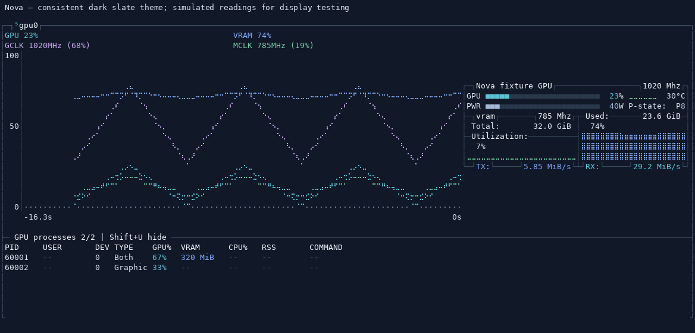

# Nova btop

A Linux fork of [aristocratos/btop](https://github.com/aristocratos/btop), based
on upstream v1.3.0. Current Nova version: **1.3.0-nova-io20**.

## AI disclosure and release privacy

**[AI generated]** Nova modifications, tests, packaging and documentation
include AI-generated content. Validation is described below; this disclosure
does not imply that upstream btop code was AI-generated. Any contribution back
to upstream must follow its current contributing guidelines.

Release defaults are generic. Packages exclude local profiles, usernames,
hostnames, private contact details, mount labels and runtime logs. The bundled
preview uses simulated data. Public repository links and required upstream
contributor/licence attribution remain. Run `python3 audit_release.py` to inspect
the built archives before upload.

## Nova theme

The default Nova theme uses a dark slate background, light text and matching
panel borders. Activity and incoming I/O are cyan; used memory and outgoing
I/O are blue. GPU clock curves use lavender and green; GPU watts use amber,
with matching legends.
Tables use neutral headings and identity text; only metrics and alerts are
coloured. Capacity is green below 80% used, amber from 80%, and red from 90%.
Small boot/EFI partitions use those same percentage thresholds.

Choose a theme in **Options → GENERAL → color_theme**. The GPU curves, mount
table and zram summary follow the selection, including older theme files.
16-colour and 256-colour fallbacks keep the same colour roles.

To apply Nova to an existing installation, run:

```sh
python3 install_nova.py --apply-theme
```

This backs up the profile, selects Nova and disables process
row fading. Other preferences remain, and later ordinary upgrades preserve
your theme choice. Fresh installations already use Nova.

## CPU view in io11

The optional full logical-processor grid has been removed, together with its
menu option and Shift+L shortcut. The standard CPU graph and compact core
readings remain. Upgrades remove the retired setting and preserve the normal
CPU graph choices and other display preferences.

## Added displays

- An upward network dot history with separate download/upload colours, matching
  the CPU/GPU style. **Options → NET → net_dot_graph** switches back to the
  earlier graph. Auto scaling, synchronized or independent scales, fixed speed
  settings, interface selection, totals and reset controls are retained. Each
  curve has a labelled byte/s scale; the vertical axis is percent of that scale.
  Auto mode includes visible peaks so bursts remain within the plot.
  The time label uses actual sample timestamps. Compact panels keep the earlier
  view, and TTY mode uses ASCII dots. Default is enabled.

- Optional CPU package watts and an upward CPU/power dot history via
  **Options → CPU → show_cpu_power**. CPU load uses 0–100%; watts use a labelled
  scale in steps of 50 W. Narrow views keep the regular CPU history and numeric
  watts where space permits. Linux RAPL counters need read access; missing
  readings show `--W` and leave gaps. Values average package energy over the
  refresh interval and exclude other system power. Generic defaults keep it off.
  For read access after reboot, the optional `prepare_cpu_power_access.py`
  helper prepares a scoped udev rule for administrator installation; see the
  [Nova PC guide](INSTALL_NOVA_PC.md#keep-cpu-watts-working-after-reboot).
- **cpu_single_graph=True** selects one ordinary upward CPU graph. Power mode
  also uses a single upward chart; it never mirrors the watt trace.
- Optional per-thread MHz beside CPU usage, in up to three columns. A
  32-thread CPU uses 11 rows, with available temperatures retained. **Shift+F**
  or **Options → CPU → show_core_freq** toggles it; generic defaults keep it off.
- With MHz and Nova layout enabled, the full CPU/GPU/memory/network/process
  view fits the CPU panel to its per-core table: 17 rows for 32 threads.
  Spare vertical space goes to network graphs and the process viewport.
  GPU histories borrow up to three extra rows from network/process space when
  the lower panels can still fit. The full-width mounts table, memory and disk
  rows are reserved when needed; short windows restore the ordinary layout.
  Process sorting, scrolling, filtering and details keep their existing behavior.
- Three compact value columns leave the remaining width to the CPU history.
  All 32 readings and temperatures fit at 87 columns with a 17-row CPU panel.

- A consistent app-wide palette with readable tables and shared metric colours.
- Wider GPU histories with a compact statistics panel: approximately one third
  of the width, bounded to 41–52 columns so small windows retain readable values.
- Mounted disks retain capacity/usage alongside live read and write MiB/s and
  separate histories. Rates use measured elapsed time between kernel samples.
  Disk labels and used-byte values have separate bright text colours; changing
  their readability keeps graph gradients and other panels unchanged.
- A persistent GPU panel with five coloured Braille dot curves: GPU load,
  allocated VRAM, graphics clock, memory clock and board power. The amber
  **PWR** trace has a labelled watt scale, at least the driver power limit,
  extended in 50 W steps for higher visible readings. Missing measurements
  show `--W` and gaps; real zero remains `0.0W`. This history uses NVIDIA NVML
  alongside the existing four metrics. Each character contains
  two horizontal points and four vertical dot levels.
- A NVIDIA GPU process summary beneath the graph: graphics/compute clients,
  GPU activity, VRAM and available host process information.
- A coloured duf-style mount table across the bottom, including filesystem,
  device, capacity, used/available bytes and percentage.
- An optional zram compression summary under RAM. Idle swap headers do not
  keep it visible; it returns automatically when real swap pages are used.



The preview uses simulated driver readings. Hardware GPU values require a
working driver and its monitoring library. The NVIDIA process summary uses
optional NVML APIs; missing values remain `--`. A compatible terminal font
must include Braille glyphs. ASCII dot fallback is available in TTY mode.

## Download and install

For a source installation from GitHub or your Gitea mirror, follow
[Install on Nova PC](INSTALL_NOVA_PC.md). Build locally, preview separately,
then install the isolated user command and select the CPU layout. The guide
also covers a saved Wi-Fi interface and optional coloured CPU wattage history.

Published binary releases are available from
[GitHub Releases](https://github.com/kuchida75/btop-nova/releases).
Source branch changes can be newer than downloadable releases; use the Nova PC
guide for the current branch.
The supplied binary targets **Linux x86-64**, with dynamically loaded GPU
support. It requires **glibc 2.38 or newer** and **libstdc++ providing
GLIBCXX_3.4.32**. The `.deb` records the precise dependencies calculated from
the binary. It was built/tested on Ubuntu 26.04.1; other distributions should
check these dependencies or build from source. No GPU driver is bundled.

Verify downloads against `SHA256SUMS` before extraction/installation:

```sh
sha256sum --ignore-missing -c SHA256SUMS
```

### Portable user installation (recommended on the existing Nova host)

```sh
tar -xzf btop-nova-1.3.0-nova-io20-linux-amd64.tar.gz
cd btop-nova-1.3.0-nova-io20-linux-amd64
python3 install_nova.py
~/.local/bin/btop
```

Close the existing btop before updating. This updates the isolated Nova user
installation and keeps your existing preferences. Fresh installations use
portable defaults that discover local disks and network interfaces. It also
adds a marked Bash alias for `btop`; open a new Bash terminal to use the alias.
The packaged `/usr/bin/btop` and `~/.config/btop` are preserved.

Nova configuration: `~/.local/share/btop-nova/config/btop/btop.conf`.
Old versioned binaries remain available under `~/.local/share/btop-nova/releases`.

To remove the Nova user command/alias while retaining its data:

```sh
python3 rollback_nova.py
```

Open a new terminal afterward, or use `unalias btop; hash -r` in the current
Bash session. `/usr/bin/btop` remains available throughout.

### Ubuntu/Debian package

```sh
sudo apt install ./btop-nova_1.3.0+nova.io20-1_amd64.deb
btop-nova
```

The package supplies the separate `btop-nova` command. It does not replace
`/usr/bin/btop`, add shell aliases or modify drivers, swap or the AI stack.
It has no maintainer scripts. Its independent profile lives at
`${XDG_CONFIG_HOME:-~/.config}/btop-nova/btop/btop.conf`, so it does not import
the existing Nova user-install profile automatically. To uninstall:

```sh
sudo apt remove btop-nova
```

## Controls

Click **keys** beside the CPU panel's menu/preset buttons, or open **menu →
Help (Keyboard shortcuts)**, to see the complete reference. **F1**, **?** and
**h** also open it (**Shift+H** in Vim mode). The keys button is shown at
100 columns or wider; the menu and keyboard entry points work at 80×24.

The reference groups global controls, GPU, disk/network, processes, editing,
options and Vim mode. Use **PgUp/PgDn**, arrows or the clickable **Prev/Next**
buttons to browse; **Home/End** jump to the first/last page. **Esc** closes it.

| Key | Nova option |
| --- | --- |
| Shift+F | Per-thread MHz / normal CPU view |
| Shift+N | Coloured GPU dot histories / previous GPU graph |
| Shift+V | Independent GPU load and VRAM histogram |
| Shift+U | Show/hide the GPU process summary |
| Shift+M | Show/hide the mounted-filesystem table |
| Shift+B | Include/hide boot and EFI disk cards |
| Shift+Z | Enable/disable the automatic zram summary |
| i | Normal disk cards / optional I/O-only view |

The same preferences are available in Options and persist. The Nova layout
allocates more GPU height, keeps top processes visible and hides swap display
initially. Zram stays hidden when unused or too little space is available.
Small panels fall back automatically; enlarging restores enabled views.
Disk throughput is block-device I/O, so cached reads and delayed writes can
differ from application copy speeds. Zram `RAM` includes allocator overhead;
`Save` is original data minus that actual RAM cost, and can be negative.

## Build and package

A C++20 compiler and GNU Make are required. On Linux x86-64 the Make build
enables GPU support by default. Do not use a fully static build if you want
dynamically loaded GPU monitoring.

```sh
make -j2 QUIET=true
sh ./launch-nova-btop
python3 package_nova.py
```

Package creation additionally needs Python 3, `dpkg-deb` and `dpkg-shlibdeps`.
It writes a portable binary archive, `.deb`, source archive, machine-readable
manifest and checksums into `dist/`. `--output DIR` selects another directory;
`--source-ref REF` selects a committed source revision. The package build
requires clean committed code so the source archive matches the binary build.

`python3 test_package.py` validates metadata, extracted commands, fresh and
existing profiles, themes, rollback and file preservation without installing
the `.deb` or writing outside a temporary test directory.

See [NOVA.txt](NOVA.txt) for display details and prior validation. The release
retains Apache-2.0 upstream attribution and the bundled library notices.
